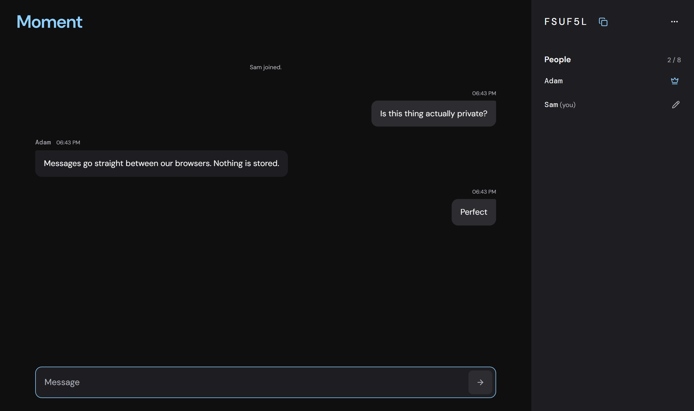

# Moment

[](https://github.com/iamzices/moment-chat/actions/workflows/ci.yml)
[](https://chat.zices.com)
[](LICENSE)

[Moment](https://chat.zices.com) is a private, temporary chat room that runs in the browser. No data is collected or stored. Messages travel peer-to-peer over WebRTC with [PeerJS](https://peerjs.com/).



## Features

- No sign-up or accounts
- Ephemeral, peer-to-peer messaging
- Chat rooms for up to 8 people

## Run locally

```sh
npm ci
npm run dev
```
